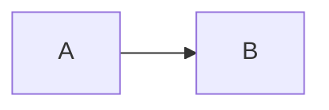

# portfolio-blog

Two Next.js apps sharing one Postgres (Supabase) database.

| App | Path | Domain | Port (dev) |
|---|---|---|---|
| Public blog | `apps/blog` | blog.aliframdani.com | 3000 |
| Admin | `apps/admin` | blog-admin.aliframdani.com | 3001 |

`packages/core` holds what both apps share: Markdown rendering (code highlighting, Mermaid), theme, and styles.

## Writing

Posts are Markdown.

````md
```ts title="server.ts" {2,4-5} showLineNumbers
```


````

- Code blocks: optional `title="…"`, highlighted lines `{2,4-5}`, `showLineNumbers`.
- `mermaid` blocks render as diagrams and follow light/dark mode.
- Images: paste, drop, or use **Add image** in the editor. They are uploaded to Supabase Storage.
- **Save draft** (⌘S) stores a version. **Publish** makes the current version live. Editing a published post does not change the live page until you publish again.
- Version history lists every saved version; any one can be restored into the editor.
- Views count every page load once per browser session. Unique readers are counted by a salted hash of IP + user agent (no cookies, no raw IPs stored).

## Setup

### 1. Supabase

1. Create a project.
2. SQL Editor → run [`db/schema.sql`](db/schema.sql). It is safe to re-run.
3. Storage → new **public** bucket named `blog-images`.
4. Connect the Supabase integration to both Vercel projects (Vercel → Storage, or the Supabase Marketplace integration). It sets `POSTGRES_URL`, `SUPABASE_URL`, `SUPABASE_SECRET_KEY` and others. Leave the env var prefix empty.

### 2. Admin password

```sh
npm install
npm run hash-password
```

It asks for the password (min 12 chars) and prints `ADMIN_PASSWORD_HASH=scrypt:…`. Only the hash goes into env vars; the password itself is stored nowhere.

### 3. Env vars

Copy `apps/blog/.env.example` → `apps/blog/.env.local` and `apps/admin/.env.example` → `apps/admin/.env.local`, then fill them in. `.env*` files are git-ignored.

Generate secrets with `openssl rand -hex 32` (`VIEW_HASH_SALT`, `SESSION_SECRET`).

### 4. Run

```sh
npm run dev:blog    # http://localhost:3000
npm run dev:admin   # http://localhost:3001
npm test
```

## Deploy (Vercel)

Create two Vercel projects from this repo:

| Project | Root directory | Domain |
|---|---|---|
| blog | `apps/blog` | blog.aliframdani.com |
| blog-admin | `apps/admin` | blog-admin.aliframdani.com |

Add each app's env vars from its `.env.example` in the Vercel project settings.

## Security notes

- The admin is guarded twice: `proxy.ts` redirects unauthenticated requests, and every page and server action checks the session again.
- Session: HS256-signed, httpOnly cookie, 7 days. Rotating `SESSION_SECRET` logs everyone out.
- Login is limited to 5 failed attempts per IP per 15 minutes. The counter lives in memory, so it resets on each serverless cold start.
- Raw HTML in Markdown is not rendered.
- All tables have RLS enabled with no policies, so Supabase's public REST API cannot read them. The apps connect as the database owner.
- `SUPABASE_SECRET_KEY` is only used server-side in the admin app.
